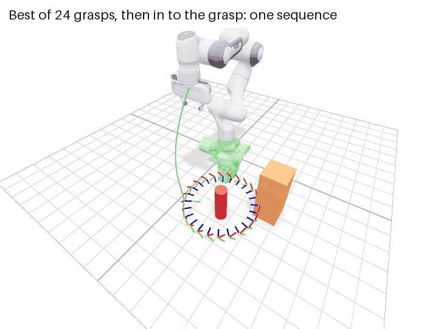

<h1 align="center">batchplan-ros</h1>

<p align="center"><em>Batched motion planning for ROS 2.</em></p>

<p align="center">
  
</p>

**ROS 2 integration for [batchplan](https://github.com/natsuku-lab/batchplan).** A standalone planner node using MoveIt messages, plus an optional MoveIt planning plugin. Planning runs on CPU threads, with optional GPU acceleration for IK and trajectory optimization through Vulkan, Metal or DX12. No CUDA required.

- **Plan:** batched pose goals, multi-arm IK, collision-aware paths and timed trajectories.
- **Sequence:** straight-line moves, blended joins, attached objects and constrained motions.
- **Execute:** send trajectories to a `FollowJointTrajectory` controller, or return a plan without executing it.

See the [batchplan README](https://github.com/natsuku-lab/batchplan#readme) for the library overview, [planning guide](https://github.com/natsuku-lab/batchplan/blob/main/docs/planning.md) for algorithms and constraints, and [benchmarks](https://github.com/natsuku-lab/batchplan/blob/main/docs/benchmarks.md) for performance comparisons.

## Quick start

With [pixi](https://pixi.sh) installed:

```bash
git clone https://github.com/natsuku-lab/batchplan-ros
cd batchplan-ros
pixi run demo                    # ROS 2 Lyrical
pixi run -e jazzy demo           # ROS 2 Jazzy
```

Open http://localhost:8080 to control a simulated Panda on ros2_control mock hardware. Drag a goal, add obstacles, then plan or execute. **Best grasp** batches candidate grasps and selects the shortest valid path before approaching and closing the gripper.

The demo runs on Linux or macOS (Apple silicon), without MoveIt or a GPU. Use `pixi run demo device:=gpu` for GPU acceleration.

`pixi run demo-tiago-pro` runs TIAGo Pro with its base and arms planned together. **Carry the tray** keeps a tray level between both hands while moving around a wall. The demo fetches PAL Robotics' model from a pinned, checksum-verified source and retains its license notices.

## ROS interfaces

`batchplan_planner` provides:

| Endpoint | Type | Purpose |
|---|---|---|
| `~/move_group` | `moveit_msgs/action/MoveGroup` | Plan and optionally execute a motion. |
| `~/sequence_move_group` | `moveit_msgs/action/MoveGroupSequence` | Plan a sequence with optional blended joins. |
| `~/compute_ik` | `moveit_msgs/srv/GetPositionIK` | Solve IK for the requested group. |
| `~/compute_cartesian_path` | `moveit_msgs/srv/GetCartesianPath` | Follow straight-line waypoints and report the completed fraction. |

Planning requests supply the scene through `planning_options.planning_scene_diff`. Multiple unconstrained goal alternatives are batched; the shortest valid path wins. Set `planner_id: "LIN"` for a straight-line move to a pose goal.

The node supports allowed robot-object contacts, Cartesian speed limits, and position/orientation constraints on IK frames, including constraints relative to another hand. Joint and visibility path constraints, rotation-vector tolerances, and path constraints on `LIN` requests are unsupported. IK and Cartesian-path services carry no scene; collision checks use the robot and objects attached to their start state.

## With MoveIt

```bash
pixi run -e moveit demo-moveit   # use -e jazzy-moveit on Jazzy
```

In RViz, select **batchplan** under **Context → Planning Library**. The plugin forwards MoveIt's planning scene to the node and returns a timed trajectory; MoveIt handles execution.

For your own configuration, add [`batchplan_planning.yaml`](batchplan_moveit/config/batchplan_planning.yaml) to its planning pipelines and launch the node with your robot's SRDF and joint limits. See [`panda_moveit_demo.launch.py`](batchplan_moveit/launch/panda_moveit_demo.launch.py).


The planner node's positive integer `sphere_budget` parameter (also an argument to
`planner.launch.py`, default `64`) controls the collision-sphere fit for the selected
robot links. With no `robot_link_roots`, this retains the legacy whole-URDF behavior,
including fixed tables and fixtures. Large robot models need a larger budget:
coarse spheres extend beyond the actual collision geometry and can reject goals
that MoveIt accepts. Increasing the budget refines that approximation without
disabling collisions or changing the trajectory's final mesh checks. Sphere fits
are cached separately for each budget; restart the planner after changing it.
The budget is a hard maximum for URDF robot spheres in budgeted mode. Models
that cannot fit it, including cached models, are rejected rather than exceeding
the cap. It is not a target sphere count; the native fitter may use coarser,
more inflated spheres to meet the budget.

### Search settings and MoveIt controls

MoveIt's `allowed_planning_time` and `num_planning_attempts` are supported.
Attempts share one overall time budget and stop at the first valid result.
Each retry changes the IK, optimization and RRT seeds; zero attempts means one.
`LIN` follows a fixed Cartesian line rather than retrying alternate paths.
MoveIt velocity/acceleration scaling and Cartesian speed caps remain supported.
The backend owns search attempts and varies their seeds on native search failure.
MoveIt's `ValidateSolution` response adapter performs final validation with the
actual planning scene. The plugin does not repeat this expensive scan inside the
search time budget or rerun successful native searches on adapter rejection.
Differences between collision models can still cause validation failures.

Both standalone actions accept cancellation during planning and execution.
Canceled planning results are discarded without sending a controller goal; native
planning already in progress may finish in its worker thread. During execution,
cancellation is forwarded to the specific controller goal, including a goal whose
acceptance is still pending. The action remains canceling until the controller
confirms a terminal result. A refused cancellation is reported as `CONTROL_FAILED`,
not as a successful stop. MoveIt contexts cancel only their own requests; canceling
a queued context does not affect the active context or submit another goal.

The backend exposes every native `IkOptions`, `PlanOptions`, `RrtOptions`,
`ShortcutOptions`, `ToolPathOptions` and `JoinOptions` search field. The `PlanOptions.time_budget` field is represented by
the request's planning time, with `default_planning_time` (5 seconds) as fallback.
In RViz, select the group and `batchplan` planner under **Context > Planning
Library**: **Planner Parameters** exposes the 50 search/sampling settings for
editing. Edits apply to subsequent plans for that group, not in-flight plans.
They are uploaded to the backend when the next MoveIt planning request starts.
They are session-only; save persistent defaults in YAML. Device, CPU threads,
sphere fitting and world geometry remain startup settings, not planner controls.

| ROS parameter prefix | Settings |
|---|---|
| `ik.*` | `seeds`, `iterations`, `damping`, `rotation_weight`, `max_step`, `collision_step`, `position_tolerance`, `rotation_tolerance`, `rng_seed` |
| `ik.collision.*` | `world`, `self_collision`, `margin`, `self_margin` |
| `planning.*` | `seeds`, `control_points`, `samples_per_span`, `iterations`, `history`, `initial_step`, `acceleration_weight`, `velocity_weight`, `validate_substeps`, `rng_seed` |
| `planning.collision.*` | `world`, `self_collision`, `margin`, `self_margin` |
| `planning.rrt.*` | `range`, `resolution`, `max_iterations`, `rng_seed`, `clearance`, `clearance_ramp` |
| `planning.shortcut.*` | `resolution`, `passes`, `min_change`, `straighten`, `clearance`, `clearance_ramp` |
| `cartesian.*` | `step`, `rotation_step`, `precision`, `rotation_precision`, `resolution`, `iterations` |
| `join.*` | `resolution` |

Other controls: `solutions_per_pose` (4), `solution_distance` (0.05 in joint space),
`trajectory_dt` (**0.02 seconds**, 20 ms), `cpu_threads` (0 = all cores) and `device`
(`cpu`/`gpu`). `ik.seeds` defaults to 32; `planning.seeds` defaults to 0 and enables
additional trajectory-optimization candidates, not additional RRT attempts.
Spatial collision resolutions are joint-space distances, not sampling times.
Pose requests can tighten the configured IK tolerances. Cartesian requests'
positive `max_step` overrides `cartesian.step`.

Use `ros2 param list /batchplan_planner` and `ros2 param get /batchplan_planner ik.seeds`
to inspect startup defaults. These ROS parameters remain read-only; the live
planner configurations use MoveIt's `/get_planner_params` and `/set_planner_params`
interfaces instead. Invalid edits fail planning explicitly and are logged by the
backend. Standalone clients can use `~/get_planner_params` and `~/set_planner_params`
on the backend; an empty planner name selects `batchplan`. Unknown groups and
planner names are rejected rather than using defaults. Valid groups inherit
global settings when no group-specific override exists. To pass persistent
settings through the standalone launch:

```yaml
# search.yaml
/**:
  ros__parameters:
    trajectory_dt: 0.02
    ik.seeds: 64
    solutions_per_pose: 8
    planning.rrt.max_iterations: 20000
```

```bash
ros2 launch batchplan_ros planner.launch.py parameters_file:=/absolute/path/search.yaml
```

The file overrides launch defaults. Through the workcell MoveIt launch, put these
settings (nested or dotted) in `batchplan.backend_parameters` in its pipeline YAML;
`default_planning_time` is the backend's fallback for requests without a time budget.
The MoveIt plugin uses the request time supplied by MoveIt.
Finer trajectory sampling is not a substitute for MoveIt's `ValidateSolution`.
The backend must be ready within 60 seconds when MoveIt loads the plugin so the
plugin can discover the actual configured defaults. Rebuild and restart both
packages together when updating this interface.

### Robot subtrees and URDF world geometry

Set the string-array parameter `robot_link_roots`, for example:

```yaml
robot_link_roots: [ur/base_link]
world_sdf_voxel_size: 0.01
```

Only the **strict descendants** of these links own robot collision geometry; the
named roots themselves are not included unless they descend from another selected
root. Multiple roots select the union of their descendants. An empty list retains
the all-robot behavior. Unknown roots, empty descendant selections, and non-fixed
joints outside the selected subtrees fail explicitly: URDF world links must be
rigidly attached to the workcell root.

All kinematic links, joints and frame transforms are retained. Only collision
ownership changes: robot links use spheres and final mesh checks; other links use
native oriented boxes, spheres and cylinders. The world loader also accepts
`<capsule radius="..." length="..."/>`, where length is the central segment's length.
Each collision origin's translation and rotation are composed with its link's
transform, including separate origins for multiple collision elements.
World meshes use conservative SDFs directly, not sphere or primitive fitting.
Watertight, consistently oriented, non-self-intersecting solid meshes are required;
nested shells/cavities are rejected.
Disconnected shells, including shells touching only at a vertex, are split and
oriented independently. Repeated Collada `instance_geometry` references and
`instance_node` elements are rejected explicitly because the current importer
does not preserve their instances. Bake those instances into unique mesh geometry
before using the file for world collisions; single-instance Collada remains supported.

World collision mesh files larger than 64 MiB are rejected before loading.
`world_sdf_voxel_size` is the maximum grid spacing in meters. The native SDF
builder rejects grids above 67,108,864 points and grids exceeding its numeric
limits before allocating grid data; resolution is never coarsened to make a grid
fit. These are fixed resource limits, not estimates of available system memory.

URDF world obstacles are retained alongside the request's planning scene, including
for IK and Cartesian services that carry no scene. SRDF and adjacent/rigid-link
exemptions survive the robot/world split; explicit request ACM entries override
them. Request objects cannot reuse URDF world-link ids to replace or remove them.
Robot caches are keyed by the collision-filtered URDF, so an all-robot cache cannot
be reused for a different collision partition.

Standalone launch example:

```bash
ros2 launch batchplan_ros planner.launch.py 'robot_link_roots:=[ur/base_link]'
```

### Collision visualization

`~/collision_spheres` publishes the **whole URDF collision model** as
`visualization_msgs/msg/MarkerArray`, with reliable transient-local QoS. Add an RViz
MarkerArray display with matching durability. Markers use link-local coordinates
and are frame-locked, so they follow the robot's TF. Equal-radius spheres are
batched for rendering. This is visualization only, not duplicate MoveIt obstacles.
Publication failures are logged but do not prevent planner initialization.
Robot spheres are cyan; native world shapes are orange. World SDF markers show
their source triangle surfaces, not a meshed SDF inflation halo. The markers
represent the URDF model (including fixed fixtures), not world objects from
individual planning requests.

## Your own robot

To plan for your own robot without MoveIt, run the node next to its `robot_state_publisher`:

```bash
pixi run ros2 launch batchplan_ros planner.launch.py robot_description_semantic:="$(cat my_robot.srdf)" \
    controller_action:=/arm_controller/follow_joint_trajectory
```

In an existing ROS 2 Lyrical or Jazzy workspace, with Rust 1.90 or later, `colcon-cargo`, `colcon-ros-cargo` and `cargo-ament-build` installed: `colcon build --packages-select batchplan_ros`.

## Development

Early-stage software. CI covers the node and browser demo on Linux and macOS, and the MoveIt plugin on Linux, for Lyrical and Jazzy.

```bash
pixi run test
pixi run test-demo
pixi run -e moveit test-moveit
```

See batchplan's [contributing guide](https://github.com/natsuku-lab/batchplan/blob/main/CONTRIBUTING.md) for conventions and its [limitations](https://github.com/natsuku-lab/batchplan#limitations) before using it on a robot.

## License

[Apache-2.0](LICENSE-APACHE) or [MIT](LICENSE-MIT), at your option. Robot models retain their own licenses.
