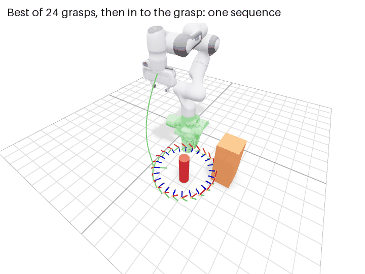

# batchplan-ros

ROS 2 motion planning with [batchplan](https://github.com/natsuku-lab/batchplan): batched IK and collision-aware planning on any GPU (Vulkan, Metal, DX12) or plain CPU threads, with no CUDA.

`batchplan_planner` is a ROS 2 node that speaks MoveIt's messages without needing MoveIt:

- `~/move_group` (`moveit_msgs/action/MoveGroup`): plans a `MotionPlanRequest` against the scene in `planning_options.planning_scene_diff`, and executes through a `FollowJointTrajectory` controller unless the goal is plan-only.
- `~/sequence_move_group` (`moveit_msgs/action/MoveGroupSequence`), as Pilz's capability of that name: plans a motion sequence's items one after another, each from where the one before ends, and returns one trajectory per run of items in one group. Each join with a `blend_radius` above 0 passes without stopping, the hand within that radius of where the motions meet, where batchplan's [`join`](https://github.com/natsuku-lab/batchplan/blob/main/docs/planning.md#joining-motions) finds that sooner and clear of collision and the items either side have the same scaling and speed cap; a sequence never takes longer than its motions one after another. The last radius is 0, and only the first item gives a start state.
- `~/compute_ik` (`moveit_msgs/srv/GetPositionIK`): it moves the request's group, and keeps the other joints where the request's state has them, as MoveIt does.
- `~/compute_cartesian_path` (`moveit_msgs/srv/GetCartesianPath`): the hand in straight lines through waypoints, as far as it reaches, with `fraction` saying how far. The service carries no scene (as with `compute_ik`), so it checks the robot and what its start state holds.

Several goal constraints in one request without path constraints are planned in one batched call, and the shortest valid path wins. One goal may place several links, such as two hands on a tray, solved as one IK problem. Planning requests also take:

- `planner_id: "LIN"`, as Pilz's planner names it: the hand moves in a straight line to its one pose goal, in the request's scene.
- The scene's `allowed_collision_matrix`: the robot's links may touch the objects it allows, as a hand touches what it grasps. Pairs of the robot's own links are the SRDF's. A start in collision is refused with `START_STATE_IN_COLLISION`, naming the link and the object (or the two links) that collide, and how deep.
- `max_cartesian_speed` on `cartesian_speed_limited_link` (an IK frame): the trajectory keeps that link under the speed, together with the scaling factors.
- Path constraints on IK frames, kept at every point the path is checked at, as batchplan's [hand constraints](https://github.com/natsuku-lab/batchplan/blob/main/docs/planning.md#constraints-along-the-path):
  - An orientation constraint in XYZ Euler angles, MoveIt's default, bounds the link's tilt by the smaller of its x and y tolerances. That cone keeps both, up to a quarter turn. The z tolerance bounds its turn about its z axis, to within the square of the tilt.
  - A position constraint is one box around the link's origin, aligned with the axes of the robot's root or of another IK frame.
  - A constraint in another IK frame's frame moves with that hand, as two hands holding one tray keep their places on it.
  - Bounds tighter than batchplan's floors (1 mm and 0.01 rad, twice that relative to another hand) count as the floors.
  - A constrained request plans its nearest goal alone, then all its goals together, in rounds that each stop at a time slice, doubling each round, until one has a path; the shortest found wins. A constrained search toward a goal it cannot reach spends all the time it is given.
  - Joint and visibility path constraints, rotation-vector tolerances, and path constraints on `LIN` requests are refused.

<p align="center">
  
</p>

## Quick start

```bash
git clone https://github.com/natsuku-lab/batchplan-ros
cd batchplan-ros
pixi run demo                                    # Linux or macOS (Apple silicon); ROS 2 Lyrical from RoboStack
pixi run -e jazzy demo                           # the same on ROS 2 Jazzy
```

Then open http://localhost:8080: a simulated Panda and its gripper on ros2_control mock hardware. Drag the gizmo to set a goal (IK runs as you drag), add boxes, and plan or plan and execute. No MoveIt and no GPU are needed; `pixi run demo device:=gpu` plans on the GPU.

`pixi run demo-tiago-pro` runs PAL Robotics' TIAGo Pro instead, its base and arms planned as one: the gizmo moves the left hand, and the base drives where the arm alone can't reach.

**Best of N grasps.** "Best grasp" sends one motion sequence. Its first item's goal constraints are the poses 8 cm before N grasps of a can, each around a different side: the node solves IK for all of them and plans to every solution in one batched call, keeping the shortest path. The second moves the hand 8 cm in along its own z to the grasp in a straight line (`LIN`, its goal in `panda_link8`'s frame), and a 4 cm blend radius lets the arm pass into it without stopping where that is sooner. The can is in the scene and the hand may touch it. The fingers then close on the can through their own trajectory controller; on the robot, the hand then lets go and backs out the same way. `ros2 run batchplan_examples best_grasp.py` times the first item, as one `MoveGroup` request with every pose, against one request per grasp, next to a running demo. Wall-clock times on an M4 Pro CPU, on Lyrical (the middle of three runs, each the median of 5 requests; other apps running):

| Grasps | One request | One request per grasp |
|---|---|---|
| 1 | 12 ms | 10 ms |
| 8 | 8 ms | 62 ms |
| 64 | 18 ms | 620 ms |

**A tray carried level, base and arms as one.** On TIAGo Pro, "Carry the tray" takes a tray in both hands from one table, around a wall, to another. That is six MoveGroup requests for the base and both arms: reach, approach, lift, carry, lower and retreat. The grippers close and open through their own controllers. The lift, carry and lower requests carry the tray as an attached object, under two path constraints: the left hand within 3° of level and free to turn about the vertical, and the right hand pinned where it holds the tray in the left hand's frame. The carry's base drives 2.2 m and turns a quarter turn around the wall. The six legs plan in about 0.7 s on an M4 Pro CPU, for 21 s of motion.

TIAGo Pro's description and meshes are PAL Robotics' (Apache 2.0). `pixi run fetch-tiago-pro`, which the TIAGo demo and the tests run first, fetches the flattened copy in Open Planning's roboplan_example_models (MIT) at a pinned commit, checks every file's SHA-256, and writes it to `batchplan_examples/tiago_pro` (git-ignored) with both notices. It also makes the base's planar joint three joints that ros2_control drives, and adds the tray frames the carry constrains.

## With MoveIt (optional)

```bash
pixi run -e moveit demo-moveit                   # -e jazzy-moveit on Jazzy
```

This is MoveIt's stock Panda demo, with a `batchplan` pipeline next to OMPL. In RViz's MotionPlanning panel, pick "batchplan" under Context → Planning Library, then Plan or Plan & Execute. The `batchplan_moveit` plugin forwards each request, with MoveIt's planning scene (its allowed collision matrix included), to the planner node, waits within the request's planning time, and hands MoveIt a timed trajectory; MoveIt's own checks and controllers take it from there. Everything without MoveIt keeps working without it: the plugin is its own package and pixi environment.

Through MoveIt's `/plan_kinematic_path`, 20 alternating identical requests per planner on an M4 Pro CPU, on Lyrical (other apps running), medians:

| Goal | Planner | Solved | Planning | Path | Motion |
|---|---|---|---|---|---|
| Round a wall | OMPL (RRTConnect) | 15/20 | 16.4 ms | 3.72 rad | 2.85 s |
| Round a wall | batchplan | 20/20 | 3.8 ms | 2.69 rad | 2.23 s |
| Free space | OMPL (RRTConnect) | 18/20 | 13.4 ms | 2.51 rad | 2.27 s |
| Free space | batchplan | 20/20 | 4.2 ms | 1.88 rad | 2.52 s |

batchplan keeps the configuration's jerk limits, which MoveIt's default time parameterization ignores, so its free-space motion is slower.

To use it with your robot's MoveIt configuration, add `batchplan_planning.yaml` (from `batchplan_moveit/config`) to your config package's planning pipelines, and run `batchplan_planner` with the robot's SRDF and joint limits as `panda_moveit_demo.launch.py` does.

The planner node's positive integer `sphere_budget` parameter (also an argument to
`planner.launch.py`, default `64`) controls the collision-sphere fit for the selected
robot links. With no `robot_link_roots`, this retains the legacy whole-URDF behavior,
including fixed tables and fixtures. Large robot models need a larger budget:
coarse spheres extend beyond the actual collision geometry and can reject goals
that MoveIt accepts. Increasing the budget refines that approximation without
disabling collisions or changing the trajectory's final mesh checks. Sphere fits
are cached separately for each budget; restart the planner after changing it.
The budget is a hard maximum for URDF robot spheres in budgeted mode. Models
that cannot fit it, including cached models, are rejected rather than exceeding
the cap. It is not a target sphere count; the native fitter may use coarser,
more inflated spheres to meet the budget.

### Search settings and MoveIt controls

MoveIt's `allowed_planning_time` and `num_planning_attempts` are supported.
Attempts share one overall time budget and stop at the first valid result.
Each retry changes the IK, optimization and RRT seeds; zero attempts means one.
`LIN` follows a fixed Cartesian line rather than retrying alternate paths.
MoveIt velocity/acceleration scaling and Cartesian speed caps remain supported.
The backend owns search attempts and varies their seeds on native search failure.
MoveIt's `ValidateSolution` response adapter performs final validation with the
actual planning scene. The plugin does not repeat this expensive scan inside the
search time budget or rerun successful native searches on adapter rejection.
Differences between collision models can still cause validation failures.

The backend exposes every native `IkOptions`, `PlanOptions`, `RrtOptions`,
`ShortcutOptions`, `ToolPathOptions` and `JoinOptions` search field. The `PlanOptions.time_budget` field is represented by
the request's planning time, with `default_planning_time` (5 seconds) as fallback.
In RViz, select the group and `batchplan` planner under **Context > Planning
Library**: **Planner Parameters** exposes the 50 search/sampling settings for
editing. Edits apply to subsequent plans for that group, not in-flight plans.
They are uploaded to the backend when the next MoveIt planning request starts.
They are session-only; save persistent defaults in YAML. Device, CPU threads,
sphere fitting and world geometry remain startup settings, not planner controls.

| ROS parameter prefix | Settings |
|---|---|
| `ik.*` | `seeds`, `iterations`, `damping`, `rotation_weight`, `max_step`, `collision_step`, `position_tolerance`, `rotation_tolerance`, `rng_seed` |
| `ik.collision.*` | `world`, `self_collision`, `margin`, `self_margin` |
| `planning.*` | `seeds`, `control_points`, `samples_per_span`, `iterations`, `history`, `initial_step`, `acceleration_weight`, `velocity_weight`, `validate_substeps`, `rng_seed` |
| `planning.collision.*` | `world`, `self_collision`, `margin`, `self_margin` |
| `planning.rrt.*` | `range`, `resolution`, `max_iterations`, `rng_seed`, `clearance`, `clearance_ramp` |
| `planning.shortcut.*` | `resolution`, `passes`, `min_change`, `straighten`, `clearance`, `clearance_ramp` |
| `cartesian.*` | `step`, `rotation_step`, `precision`, `rotation_precision`, `resolution`, `iterations` |
| `join.*` | `resolution` |

Other controls: `solutions_per_pose` (4), `solution_distance` (0.05 in joint space),
`trajectory_dt` (**0.02 seconds**, 20 ms), `cpu_threads` (0 = all cores) and `device`
(`cpu`/`gpu`). `ik.seeds` defaults to 32; `planning.seeds` defaults to 0 and enables
additional trajectory-optimization candidates, not additional RRT attempts.
Spatial collision resolutions are joint-space distances, not sampling times.
Pose requests can tighten the configured IK tolerances. Cartesian requests'
positive `max_step` overrides `cartesian.step`.

Use `ros2 param list /batchplan_planner` and `ros2 param get /batchplan_planner ik.seeds`
to inspect startup defaults. These ROS parameters remain read-only; the live
planner configurations use MoveIt's `/get_planner_params` and `/set_planner_params`
interfaces instead. Invalid edits fail planning explicitly and are logged by the
backend. Standalone clients can use `~/get_planner_params` and `~/set_planner_params`
on the backend; an empty planner name selects `batchplan`. Unknown groups and
planner names are rejected rather than using defaults. Valid groups inherit
global settings when no group-specific override exists. To pass persistent
settings through the standalone launch:

```yaml
# search.yaml
/**:
  ros__parameters:
    trajectory_dt: 0.02
    ik.seeds: 64
    solutions_per_pose: 8
    planning.rrt.max_iterations: 20000
```

```bash
ros2 launch batchplan_ros planner.launch.py parameters_file:=/absolute/path/search.yaml
```

The file overrides launch defaults. Through the workcell MoveIt launch, put these
settings (nested or dotted) in `batchplan.backend_parameters` in its pipeline YAML;
`default_planning_time` is the backend's fallback for requests without a time budget.
The MoveIt plugin uses the request time supplied by MoveIt.
Finer trajectory sampling is not a substitute for MoveIt's `ValidateSolution`.
The backend must be ready within 60 seconds when MoveIt loads the plugin so the
plugin can discover the actual configured defaults. Rebuild and restart both
packages together when updating this interface.

### Robot subtrees and URDF world geometry

Set the string-array parameter `robot_link_roots`, for example:

```yaml
robot_link_roots: [ur/base_link]
world_sdf_voxel_size: 0.01
```

Only the **strict descendants** of these links own robot collision geometry; the
named roots themselves are not included unless they descend from another selected
root. Multiple roots select the union of their descendants. An empty list retains
the all-robot behavior. Unknown roots, empty descendant selections, and non-fixed
joints outside the selected subtrees fail explicitly: URDF world links must be
rigidly attached to the workcell root.

All kinematic links, joints and frame transforms are retained. Only collision
ownership changes: robot links use spheres and final mesh checks; other links use
native oriented boxes, spheres and cylinders. The world loader also accepts
`<capsule radius="..." length="..."/>`, where length is the central segment's length.
Each collision origin's translation and rotation are composed with its link's
transform, including separate origins for multiple collision elements.
World meshes use conservative SDFs directly, not sphere or primitive fitting.
Watertight, consistently oriented, non-self-intersecting solid meshes are required;
nested shells/cavities are rejected.
Disconnected shells, including shells touching only at a vertex, are split and
oriented independently. Repeated Collada `instance_geometry` references and
`instance_node` elements are rejected explicitly because the current importer
does not preserve their instances. Bake those instances into unique mesh geometry
before using the file for world collisions; single-instance Collada remains supported.

World collision mesh files larger than 64 MiB are rejected before loading.
`world_sdf_voxel_size` is the maximum grid spacing in meters. The native SDF
builder rejects grids above 67,108,864 points and grids exceeding its numeric
limits before allocating grid data; resolution is never coarsened to make a grid
fit. These are fixed resource limits, not estimates of available system memory.

URDF world obstacles are retained alongside the request's planning scene, including
for IK and Cartesian services that carry no scene. SRDF and adjacent/rigid-link
exemptions survive the robot/world split; explicit request ACM entries override
them. Request objects cannot reuse URDF world-link ids to replace or remove them.
Robot caches are keyed by the collision-filtered URDF, so an all-robot cache cannot
be reused for a different collision partition.

Standalone launch example:

```bash
ros2 launch batchplan_ros planner.launch.py 'robot_link_roots:=[ur/base_link]'
```

### Collision visualization

`~/collision_spheres` publishes the **whole URDF collision model** as
`visualization_msgs/msg/MarkerArray`, with reliable transient-local QoS. Add an RViz
MarkerArray display with matching durability. Markers use link-local coordinates
and are frame-locked, so they follow the robot's TF. Equal-radius spheres are
batched for rendering. This is visualization only, not duplicate MoveIt obstacles.
Publication failures are logged but do not prevent planner initialization.
Robot spheres are cyan; native world shapes are orange. World SDF markers show
their source triangle surfaces, not a meshed SDF inflation halo. The markers
represent the URDF model (including fixed fixtures), not world objects from
individual planning requests.

## Your own robot

To plan for your own robot without MoveIt, run the node next to its `robot_state_publisher`:

```bash
pixi run ros2 launch batchplan_ros planner.launch.py robot_description_semantic:="$(cat my_robot.srdf)" \
    controller_action:=/arm_controller/follow_joint_trajectory
```

In an existing ROS 2 Lyrical or Jazzy workspace, with Rust 1.90 or later, `colcon-cargo`, `colcon-ros-cargo` and `cargo-ament-build` installed: `colcon build --packages-select batchplan_ros`.

## Status

Early: ROS 2 Lyrical Luth (the 2026 LTS) and Jazzy Jalisco (the 2024 LTS). CI builds and tests the node and the browser demo on both, on Linux (x86-64) and macOS (Apple silicon), and the MoveIt plugin on both, on Linux. rclrs 0.8.0 ends the node on Lyrical when a client leaves ([ros2-rust/ros2_rust#730](https://github.com/ros2-rust/ros2_rust/pull/730)), so the node builds rclrs from that fix's commit until a release includes it. The Rust node follows [Google's Rust style guide](https://google.github.io/styleguide/rustguide.html), as batchplan does; its [contributing guide](https://github.com/natsuku-lab/batchplan/blob/main/CONTRIBUTING.md) has the commands and the choices.
