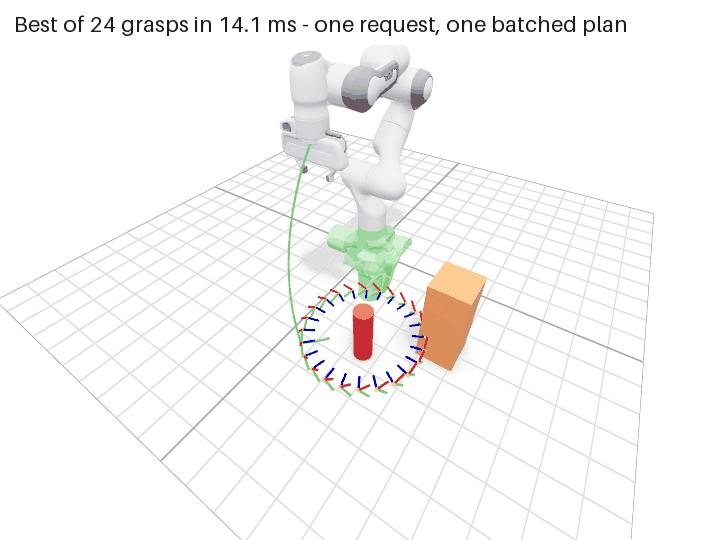

# batchplan-ros

ROS 2 motion planning with [batchplan](https://github.com/natsuku-lab/batchplan): batched IK and collision-aware planning on any GPU (Vulkan, Metal, DX12) or plain CPU threads, with no CUDA.

`batchplan_planner` is a ROS 2 node that speaks MoveIt's messages without needing MoveIt:

- `~/move_group` (`moveit_msgs/action/MoveGroup`): plans a `MotionPlanRequest` against the scene in `planning_options.planning_scene_diff`, and executes through a `FollowJointTrajectory` controller unless the goal is plan-only.
- `~/compute_ik` (`moveit_msgs/srv/GetPositionIK`).

Several goal constraints in one request are planned in one batched call, and the shortest valid path wins.



## Quick start

The node builds [batchplan](https://github.com/natsuku-lab/batchplan) from source, from a checkout beside this one:

```bash
git clone https://github.com/natsuku-lab/batchplan
git clone https://github.com/natsuku-lab/batchplan-ros
cd batchplan-ros
pixi run demo                                    # Linux or macOS (Apple silicon); ROS 2 Jazzy from RoboStack
```

Then open http://localhost:8080: a simulated Panda on ros2_control mock hardware. Drag the gizmo to set a goal (IK runs as you drag), add boxes, and plan or plan and execute. No MoveIt and no GPU are needed; `pixi run demo device:=gpu` plans on the GPU.

**Best of N grasps.** "Best grasp" sends one request with N approach poses around a can as its goal constraints. The node solves IK for all of them and plans to every solution in one batched call, keeping the shortest path. `ros2 run batchplan_examples best_grasp.py` times that against one request per grasp, next to a running demo. Wall-clock times on an M4 Pro CPU (the middle of three runs, each the median of 5 requests; other apps running):

| Grasps | One request | One request per grasp |
|---|---|---|
| 1 | 11 ms | 10 ms |
| 8 | 8 ms | 51 ms |
| 64 | 19 ms | 586 ms |

## With MoveIt (optional)

```bash
pixi run -e moveit demo-moveit
```

This is MoveIt's stock Panda demo, with a `batchplan` pipeline next to OMPL. In RViz's MotionPlanning panel, pick "batchplan" under Context → Planning Library, then Plan or Plan & Execute. The `batchplan_moveit` plugin forwards each request, with MoveIt's planning scene, to the planner node, waits within the request's planning time, and hands MoveIt a timed trajectory; MoveIt's own checks and controllers take it from there. Everything without MoveIt keeps working without it: the plugin is its own package and pixi environment.

Through MoveIt's `/plan_kinematic_path`, 20 alternating identical requests per planner on an M4 Pro CPU (other apps running), medians:

| Goal | Planner | Solved | Planning | Path | Motion |
|---|---|---|---|---|---|
| Round a wall | OMPL (RRTConnect) | 16/20 | 15.3 ms | 3.84 rad | 2.59 s |
| Round a wall | batchplan | 20/20 | 4.0 ms | 2.69 rad | 2.23 s |
| Free space | OMPL (RRTConnect) | 16/20 | 14.2 ms | 3.13 rad | 2.43 s |
| Free space | batchplan | 20/20 | 4.6 ms | 1.88 rad | 2.52 s |

batchplan keeps the configuration's jerk limits, which MoveIt's default time parameterization ignores, so its free-space motion is slower.

To use it with your robot's MoveIt configuration, add `batchplan_planning.yaml` (from `batchplan_moveit/config`) to your config package's planning pipelines, and run `batchplan_planner` with the robot's SRDF and joint limits as `panda_moveit_demo.launch.py` does.

## Your own robot

To plan for your own robot without MoveIt, run the node next to its `robot_state_publisher`:

```bash
pixi run ros2 launch batchplan_ros planner.launch.py robot_description_semantic:="$(cat my_robot.srdf)" \
    controller_action:=/arm_controller/follow_joint_trajectory
```

In an existing ROS 2 Jazzy workspace, with `colcon-cargo`, `colcon-ros-cargo` and `cargo-ament-build` installed: `colcon build --packages-select batchplan_ros`.

## Status

Early: ROS 2 Jazzy only. CI builds and tests the node and the browser demo on Linux (x86-64) and macOS (Apple silicon), and the MoveIt plugin on Linux.
